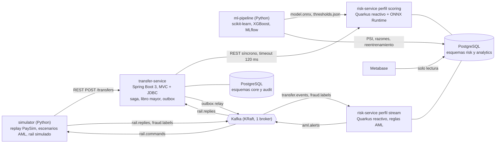

# VeraBank

Banco digital de laboratorio: transferencias con saga, libro mayor de doble partida y outbox; scoring de fraude en
línea con un modelo entrenado en Python y servido en ONNX; reglas AML en streaming; monitoreo de drift, BI y una prueba
de carga. Diseño completo en `docs/diseno.md`; decisiones en `docs/adr/`.

## 1. Problema

Un banco digital debe mover dinero sin duplicar ni perder fondos y decidir el riesgo de cada transferencia en menos de
150 ms. VeraBank lo resuelve con una saga orquestada sobre PostgreSQL y Kafka, idempotencia en tres capas, scoring
síncrono con fallback por monto y conciliación contable verificable.

## 2. Arquitectura



| Componente | Tecnología | Rol | Más |
|---|---|---|---|
| `transfer-service/` | Java 21, Spring Boot 3.5.16 | API de transferencias, saga, libro mayor, outbox, auditoría encadenada | ADR-01, 02, 03, 10 |
| `risk-service/` | Java 21, Quarkus 3.40 (LTS) | Un servicio, dos despliegues: `scoring` (ONNX, features online) y `stream` (reglas AML) | ADR-04, 05, 07, 08 |
| `simulator/` | Python 3.12 | Rail interbancario simulado, replay de PaySim, generador AML, siembra y carga | ADR-12 |
| `ml/` | Python 3.12, XGBoost 3.4.1, MLflow | Features, entrenamiento, exportación a ONNX, PSI, razones, reentrenamiento | ADR-11, 13 |
| `db/` | PostgreSQL 16, Flyway | Un esquema por servicio, roles mínimos, verificador de la cadena de auditoría | ADR-09 |
| `bi/` | Metabase v0.64.6.3 | Dashboard de riesgo creado por API | ADR-13 (D9) |
| `deploy/kind/` | Kustomize, kind v0.33.0 | Despliegue opcional en Kubernetes local | ADR-13 (D12) |

Decisiones: `docs/adr/ADR-01.md` a `ADR-13.md`. Contratos de eventos y API: `contracts/`.

## 3. Datos

- **PaySim** (transacciones móviles sintéticas): entrenamiento, validación, prueba y replay. Licencia **CC BY-SA 4.0**;
  los artefactos derivados (`ml/artifacts/model.onnx`, `challenger/model.onnx`, `golden*.jsonl`) se distribuyen bajo la
  misma licencia con la atribución de la ficha del dataset (`ml/README.md`). Se descarga con `make data`; no se versiona.
- **Escenarios AML**: generador propio (`make amlgen`) con verdad de terreno; tipologías STRUCTURING, COUNTRY_RISK y
  FAN_IN.
- **Lista de países de riesgo**: publicaciones del GAFI/FATF, con fecha de vigencia (`db/seed/country_risk.csv`).
- **Limitaciones de lo sintético**: PaySim tiene un cambio de régimen cerca del paso 400 y un volumen por paso que cae de
  11.289 (entrenamiento) a 740 (prueba); `is_new_beneficiary` vale siempre 1; las métricas no son las de un banco real.
  La CI usa una muestra sintética de 50.000 filas con el esquema de PaySim (no la descarga).

## 4. Resultados a medir

Cifras propias, medidas en la laptop de referencia (WSL2 con Docker Desktop, 12 núcleos, 15,5 GB visibles). La columna
«Fuente» dice con qué se mide. Detalle de las reglas AML y del rail en `docs/resultados/aml-eval.md` y
`docs/resultados/diagnostico-rail.md`. Los objetivos de `docs/diseno.md` §1.2 no son resultados.

| Medida | Resultado | Fuente |
|---|---|---|
| PR-AUC en validación (bloques de 24 pasos) | XGBoost 0,5626 [0,4802; 0,6442]; regresión logística 0,3595 [0,2488; 0,4788] | `ml/reports/model-report.md` |
| Modelo elegido en prueba (`fraud-xgb/6`) | PR-AUC 0,6029; recall 52,26 % a FPR 0,5 % y 39,63 % a FPR 0,1 % | `ml/reports/test_evaluation.json` |
| Costo frente a no tener modelo (prueba) | 713,1 M frente a 2.979,1 M: −76,06 %; recall de REVIEW o BLOCK 48,17 % | ídem |
| p95 de scoring a 50 TPS (k6 directo, 30 min) | 4,54 ms (p99 5,43 ms); pico de 100 TPS: 4,31 ms; 16 errores en 90.000 (0,018 %) | `make perf-scoring DURATION=30m PEAK=1` |
| p95 de `POST /transfers` (T-17, 50 TPS 30 min + pico de 100 TPS 5 min) | 265,7 ms (p50 15,8, p99 1.301,5); a 50 TPS sostenidos, 21,5 ms; 0 % fuera de 200/201/422 | `make load-transfers DURATION=30m PEAK=1` |
| Replay de PaySim (20.000 transferencias a 50 TPS) | p95 de `POST /transfers` 54,9 ms; 3 `FALLBACK` de 20.000; conciliación 0 y 0 | `make replay N=20000 TPS=50` |
| Compensación de las FAILED en el pico de 100 TPS | 77,79 % por debajo de 60 s (n = 7.347; objetivo 99 %: **no cumple**, ver §6) | `make reconcile-full` |
| Duplicados y descuadres tras la carga y la caída de PostgreSQL | 0 duplicados, 0 descuadres, 0 estados no finales; cadena de auditoría íntegra (299.887 filas); tras reiniciar PostgreSQL, 1 error en 450 solicitudes y normalidad a los 0,4 s | `make reconcile-full`, `make pg-restart-test`, `make verify-audit` |
| Precisión y recall por regla AML | STRUCTURING 100 % / 62,50 %; COUNTRY_RISK 100 % / 56,67 % (techos de cobertura 62,50 % y 65,00 %) | `aml-eval.md` |
| Ratio de impacto dispar | **No medido**: el modelo de crédito (ampliación 3.G) no se construyó | — |
| PSI en la demostración de drift (referencia `valid`) | base 0,018 / 0,028; deriva (montos × 3) 0,379 / 0,496 en el score y 0,653 / 0,526 en `log_amount`: alerta en la ventana 649–672 | `make drift-demo`, ADR-13 D15 |
| Arranque en frío | primera llamada de scoring tras `ready` 20–33 ms en tres arranques desde cero | `make smoke` sobre una base nueva |
| Caos en kind (borrado forzado de un pod de scoring a 20 TPS) | 100 % de éxito, 0 `FALLBACK`, reemplazo `Ready` en 7 s | `make kind-chaos` |
| Memoria | Compose: máx. 2,46 GiB bajo T-17 (objetivo ≤ 8 GB); kind: 5,50 GiB reales con límites de 7,88 GiB (≤ 10 GiB) | `docker stats` durante la carga |

## 5. Cómo ejecutar

Requisitos: Docker (con Compose), Java 21, `uv` y Python 3.12; `.env` copiado de `.env.example` con credenciales propias.

```bash
make data                         # PaySim en data/raw (licencia CC BY-SA 4.0)
make ml-features && make ml-train && make ml-export   # modelo y artefactos (opcional: ya están en ml/artifacts)
make up                           # PostgreSQL, Kafka, transfer-service, risk-scoring, risk-stream y el rail simulado
make smoke                        # humo de extremo a extremo
make replay N=20000 TPS=50        # replay de PaySim por la API
make bi-up                        # Metabase: http://localhost:3000/dashboard/2
make drift-demo CONFIRM=yes       # DESTRUCTIVO: borra los datos de Compose y corre la demostración de drift
make help                         # todos los objetivos
```

MLflow: `uv run --project ml mlflow ui --backend-store-uri sqlite:///ml/mlflow.db` (http://localhost:5000).

## 6. Decisiones y concesiones

- **Spring Boot 3.5 sin soporte open source.** transfer-service usa Spring Boot 3.5.16 (ADR-10); la migración a 4.1 es
  el primer cambio para producción.
- **Cuello del rail (diagnosticado, sin resolver).** La cadena de auditoría toma `pg_advisory_xact_lock(815001)` y lo
  retiene hasta el commit, con su `fsync`: techo de ≈ 72–82 transferencias/s en la laptop. A 50 TPS va holgado; en el
  pico de 100 TPS la cola de `rail.replies.v1` crece y la compensación de las FAILED cumple solo un 77,8 % bajo 60 s
  (objetivo 99 %). Las salidas son de diseño (auditoría por lotes, encadenado asíncrono del hash) y quedan pendientes de
  decisión (`docs/resultados/diagnostico-rail.md`).
- **PSI contra `valid` en vez de `train` (desviación de §5f).** Los umbrales de decisión se fijaron en validación y,
  contra entrenamiento, el score diverge sin deriva (PSI 0,37–0,43); `train` se sigue calculando como medida informativa
  (ADR-13 D14).
- **Calentamiento dirigido de historia.** El replay carga una fila por destino en su primera aparición en PaySim, así
  `dst_seen_before` y `dst_age_hours` coinciden con el entrenamiento (paridad 0 diferencias en 17 features; ADR-13 D13).
- **Promoción y rollback no verificables con los datos.** Exigen ≥ 24 pasos en sombra con etiquetas maduras (48 pasos
  más) y la partición de prueba termina en el paso 744; la lógica está cubierta por pruebas (ADR-13 D8).
- **Auditoría sin ancla externa.** `audit.verify_chain` detecta alteraciones, borrados y huecos intermedios, pero no el
  truncado del final ni la reescritura completa de la cadena (ADR-13 D5).
- Simplificaciones de laboratorio: un broker de Kafka, una instancia de PostgreSQL con esquemas por servicio, alertas
  AML publicadas sin outbox (ADR-12) y la muestra sintética en la CI.

## Licencia y atribuciones

Código del repositorio: su propia licencia. Datos y artefactos derivados de PaySim: CC BY-SA 4.0, con la atribución de
la ficha del dataset (ver `ml/README.md`).
