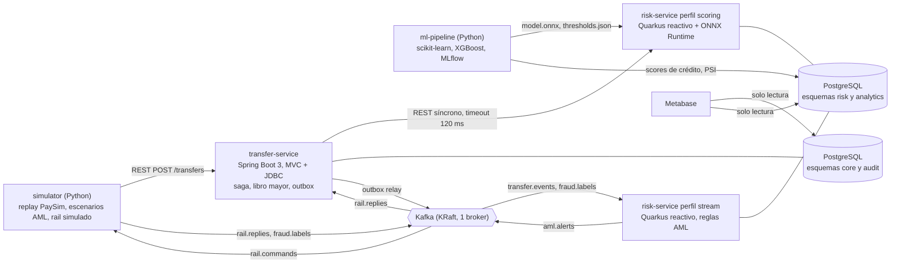

# VeraBank — Diseño de arquitectura y ciencia de datos

Documento de diseño: decisiones, contratos y plan de construcción, sin implementación. `VERIFICAR` marca lo que debe confirmarse antes de construir.

## 1. Requisitos

### 1.1 Historias de usuario

| ID | Historia | Criterio de aceptación |
|---|---|---|
| HU-01 | Como cliente quiero transferir a una cuenta interna o externa | Respuesta con `transfer_id` y estado; el saldo disponible nunca queda negativo |
| HU-02 | Como canal quiero reintentar sin duplicar | Misma `Idempotency-Key` ⇒ un solo débito |
| HU-03 | Como cliente quiero recuperar mi dinero si el abono falla | Retención liberada en < 60 s tras el rechazo; estado `FAILED` |
| HU-04 | Como analista de fraude quiero que toda transferencia se puntúe antes de aprobarse | Decisión `APPROVE/REVIEW/BLOCK` con score, versión de modelo y origen |
| HU-05 | Como analista de fraude quiero resolver las transferencias retenidas | Aprobar reanuda la saga; rechazar la compensa; ambas se auditan |
| HU-06 | Como oficial de cumplimiento quiero alertas AML por umbral, fraccionamiento y país de riesgo | Alerta con regla, versión, parámetros y transferencias que la sustentan |
| HU-07 | Como auditor quiero una traza inmutable | Registro de solo inserción con cadena de hash verificable |
| HU-08 | Como analista de crédito quiero un score por lote explicable | Score, banda y tres razones por cliente |
| HU-09 | Como gerente de riesgo quiero ver los KPIs | Dashboard con los cinco KPIs de §5g |
| HU-10 | Como ingeniero de ML quiero detectar drift y reentrenar | PSI por feature, alerta sobre umbral, reentrenamiento con un comando |

### 1.2 Requisitos no funcionales

| Atributo | Objetivo | Medición |
|---|---|---|
| Latencia de scoring | p95 < 150 ms y p99 < 300 ms a 50 TPS, medida en el cliente. Presupuesto: red 5 ms, features 40, inferencia 10, bitácora 10 | Histograma por etapa; k6 |
| Latencia de `POST /transfers` | p95 < 400 ms | k6 |
| Throughput | 50 TPS durante 30 min; pico de 100 TPS 5 min, sin pérdidas ni duplicados | k6 + conciliación |
| Disponibilidad | Diseño para 99,9 % (2 réplicas en kind). Con el scoring caído, ≥ 99 % de solicitudes aceptadas por fallback | Prueba de caos |
| Consistencia | 0 débitos duplicados; Σ débitos = Σ créditos; RPO 0 en transferencias confirmadas | Conciliación SQL (§7) |
| Compensación | 99 % de sagas fallidas compensadas en < 60 s; ninguna atascada > 15 min sin alerta | Métrica `saga.stuck` |
| Mensajería | At-least-once con consumidores idempotentes; retraso del outbox p95 < 1 s | Métrica `outbox.lag` |
| Alertas AML | p95 < 5 s entre evento y alerta persistida | KPI 3 |
| Lote de crédito | 30.000 clientes en < 5 min | Duración del job |
| Recursos | Compose ≤ 8 GB de RAM; kind ≤ 10 GB | `docker stats` |

### 1.3 Supuestos

- Moneda única (`PEN`). El rail interbancario es un simulador propio.
- Tiempo de negocio simulado: cada solicitud lleva `occurred_at` y todas las ventanas (features, AML) lo usan. La latencia se mide con reloj real.
- Las etiquetas de fraude llegan 24 h simuladas después, por un tópico propio.
- Seguridad mínima: API key por canal y rol de solo lectura para BI. Sin frontend: el analista usa endpoints y Metabase.
- Laptop de referencia: 16 GB de RAM, 8 núcleos.

## 2. Arquitectura

### 2.1 Diagrama



### 2.2 Servicios

| Servicio | Responsabilidad | Tecnología y justificación |
|---|---|---|
| `transfer-service` | API, cuentas, libro mayor, orquestador de la saga, outbox, idempotencia | Spring Boot 3 con MVC, JDBC y virtual threads: el modelo bloqueante encaja con transacciones ACID y es fácil de razonar |
| `risk-service` | Una base de código, dos despliegues. `scoring`: features online e inferencia. `stream`: reglas AML, alertas, etiquetas | Quarkus reactivo: E/S no bloqueante para sostener el p95 con poca memoria |
| `ml-pipeline` | Entrenamiento, MLflow, exportación a ONNX, lote de crédito, explicabilidad, PSI | Python; corre como jobs, no como servicio |
| `simulator` | Replay de PaySim, generador AML etiquetado, rail con fallos inyectables, etiquetas tardías | Python; aísla todo lo simulado fuera de los servicios de negocio |
| `metabase` | Dashboards sobre vistas de `analytics` | Edición open source, rol de solo lectura |

### 2.3 Flujo de la saga

```text
POST /transfers (Idempotency-Key)
 tx1  insertar transferencia PENDING (unicidad client_id + clave)
      retener fondos (UPDATE condicional) · saga = FUNDS_HELD · outbox(TransferInitiated)
 --   score = FraudScorer.score(req)        # fuera de transacción; timeout 120 ms; fallback
 tx2  BLOCK   -> liberar retención · REJECTED
      REVIEW  -> saga = IN_REVIEW                               (espera al analista)
      APPROVE -> INTERNAL: asientos D/C · COMPLETED
                 EXTERNAL: saga = CREDIT_REQUESTED · outbox(CreditInstruction)
 async CreditConfirmed -> asientos D origen / C compensación · COMPLETED
       CreditRejected  -> COMPENSATING -> liberar retención -> COMPENSATED · FAILED
       sin respuesta en 30 s -> CreditStatusQuery (nunca se compensa a ciegas)
 poller sagas con wake_at vencido (FOR UPDATE SKIP LOCKED): reintento con backoff;
        tras 5 intentos -> COMPENSATION_FAILED + alerta operativa
```

Una caída entre `tx1` y `tx2` la recupera el poller: vuelve a pedir el score (idempotente por `transfer_id`) y continúa.

### 2.4 Patrones

| Patrón | Dónde | Para qué |
|---|---|---|
| Saga orquestada + máquina de estados | `transfer-service` | Consistencia entre retención, scoring y abono externo, con compensación explícita |
| Outbox + Inbox | `core.outbox`, `processed_messages` | Publicar sin escritura dual; consumir sin efectos duplicados |
| Circuit Breaker, Timeout, Fallback | Llamada a scoring (Resilience4j) | Acotar la latencia y degradar con reglas |
| Strategy | `FraudScorer` (remoto, fallback, stub), `DecisionPolicy` | Cambiar scorer o umbrales sin tocar la saga |
| Chain of Responsibility | Reglas AML: exención → umbral → fraccionamiento → país → fan-in | Añadir reglas sin modificar las existentes; la exención corta la cadena, las demás acumulan |
| Champion/Challenger en sombra | `risk-service` | Evaluar un modelo nuevo con tráfico real sin que decida |
| Auditoría con cadena de hash | `audit.audit_log` | Evidencia de que el registro no fue alterado |

### 2.5 Decisiones de arquitectura (ADR)

**ADR-01 · Saga orquestada**
- Contexto: tres participantes (libro mayor, scoring, rail) y compensaciones con orden estricto. Dos cuentas en la misma base no necesitan saga.
- Opciones: orquestada; coreografiada por eventos; transacción local.
- Decisión: orquestada, con estado en `core.saga_state`. En transferencias internas el abono es un paso local y atómico de la misma máquina de estados.
- Consecuencias: flujo legible y testeable; la saga se justifica por el tramo externo. El orquestador concentra la lógica. Un timeout del rail no equivale a fallo: se consulta antes de compensar.

**ADR-02 · Outbox con relay por sondeo**
- Contexto: cambiar estado y publicar el evento debe ser atómico.
- Opciones: publicar directo tras el commit; outbox + sondeo; outbox + CDC (Debezium).
- Decisión: outbox + sondeo. Un solo relay activo mediante bloqueo consultivo; lotes de 200 cada 100 ms.
- Consecuencias: sin eventos perdidos ni fantasma; entrega at-least-once y hasta 100 ms de retraso. Debezium reduce la latencia pero añade Kafka Connect a la laptop.

**ADR-03 · Idempotencia en tres capas**
- Contexto: reintentos del cliente, reentregas de Kafka y reintentos de la saga.
- Opciones: tabla de claves con respuesta almacenada; clave como restricción única de la transferencia.
- Decisión: la segunda. API: `UNIQUE (client_id, idempotency_key)` más `request_hash`; toda solicitud válida crea una fila aunque se rechace. Consumidores: `processed_messages` en la misma transacción que el efecto. Libro mayor: unicidad por transferencia, cuenta, sentido y tipo.
- Consecuencias: la restricción resuelve la carrera entre duplicados concurrentes; el reintento devuelve el estado actual, no una copia de la respuesta original.

**ADR-04 · Scoring síncrono con fallback**
- Contexto: hay que puntuar antes de aprobar.
- Opciones: REST síncrono; petición y respuesta por Kafka; asíncrono tras aprobar.
- Decisión: REST síncrono con timeout de 120 ms y circuit breaker. Ante fallo no se rechaza ni se aprueba todo: monto ≤ 500 aprueba, mayor pasa a `REVIEW`, con `decision_source = FALLBACK`.
- Consecuencias: latencia acotada y medible; el banco sigue operando con riesgo limitado y la tasa de fallback es un KPI. Kafka añadiría dos saltos al p95; el asíncrono incumple el requisito.

**ADR-05 · Modelo en ONNX dentro del servicio Java**
- Contexto: inferencia en el camino crítico de 150 ms.
- Opciones: servicio Python (FastAPI); ONNX Runtime en `risk-service`; XGBoost4J.
- Decisión: ONNX Runtime. Python entrena y exporta; Java sirve.
- Consecuencias: un salto de red menos y un solo formato para ambos modelos. Riesgo de divergencia entre entrenamiento y servicio, cubierto con pruebas de paridad. ONNX Runtime usa JNI: modo JVM, sin imagen nativa.

**ADR-06 · Claves y particiones de Kafka**
- Contexto: AML necesita orden por cuenta; la saga, por transferencia.
- Opciones: `transfer_id` en todo; cuenta de origen en eventos de negocio.
- Decisión: `transfer.events` con clave `source_account_id` y 6 particiones; tópicos del rail con clave `transfer_id` y 3. Un tópico por agregado con varios tipos de evento.
- Consecuencias: orden por cuenta de origen. Las reglas por destino (fan-in) no tienen orden global: se evalúan por ventana de tiempo de negocio con upsert idempotente. Replicación 1 en la laptop; en producción, 3 con `min.insync.replicas=2`.

**ADR-07 · Features online desde la bitácora de scoring**
- Contexto: las features de velocidad necesitan historial reciente y consistente.
- Opciones: proyección alimentada por Kafka; Redis; la tabla `risk.scoring_log` que el servicio escribe en cada solicitud.
- Decisión: `scoring_log`, con dos consultas index-only concurrentes.
- Consecuencias: sin retraso de consumidor ni componente nuevo; la misma tabla alimenta PSI y reentrenamiento. Cuenta intentos, igual que el dataset de entrenamiento. No escala a miles de TPS; ahí entraría Redis.

**ADR-08 · Un servicio Quarkus, dos despliegues**
- Contexto: el stack fija un único servicio Quarkus, pero scoring y AML tienen cargas distintas.
- Opciones: un proceso con todo; misma imagen con perfil `scoring` o `stream`.
- Decisión: dos perfiles.
- Consecuencias: recursos aislados y escalado independiente sin duplicar código; exige disciplina de paquetes para separarlo después.

**ADR-09 · Una instancia de PostgreSQL, esquemas por servicio**
- Contexto: memoria limitada.
- Opciones: instancia por servicio; una instancia con esquemas y roles.
- Decisión: una instancia. Ningún servicio lee el esquema de otro; solo las vistas de `analytics` cruzan esquemas, para BI.
- Consecuencias: ahorra memoria; el aislamiento es lógico, no físico.

**ADR-10 · Versión de Spring Boot**
- Contexto: el stack pide Spring Boot 3, pero la línea 3.5 dejó de recibir parches open source el 30 de junio de 2026.
- Opciones: 3.5.x; 4.x.
- Decisión: 3.5.x, último parche, evitando APIs retiradas en 4.x.
- Consecuencias: respeta el stack, pero publicar sobre una línea sin soporte invita preguntas. Primera decisión a revisar (§8).

**ADR-11 · Criterio de selección del modelo de fraude con pocos bloques de validación**
- Contexto: §5d sirve el boosting solo si mejora el PR-AUC en 0,02 o más con intervalos que no se solapan, baja el costo y su p95 es < 10 ms. Los intervalos son por bootstrap de bloques de pasos y `valid` (pasos 425–550) solo tiene 6 bloques de 24 pasos (21 de 6 pasos); `test`, 8 y 29. Con menos de 10 bloques el intervalo es poco fiable.
- Opciones: detener la selección y decidir a mano cuando hay menos de 10 bloques; reducir el bloque a 6 pasos; evaluar con 24 y contrastar con 6.
- Decisión: el criterio se evalúa con bloques de 24 pasos y se contrasta con los de 6; pasa solo si no hay solape con ambos tamaños, y si el resultado difiere cuenta como no cumplido. Tener menos de `min_blocks` bloques no detiene la selección ni la deja indeterminada: se registra como advertencia en `selection.json` y en `model-report.md`. `--winner` queda como override manual, registrado como tal. Con los datos actuales gana XGBoost (`fraud-xgb`, depth 6, `scale_pos_weight` 300): PR-AUC 0,563 [0,480–0,644] frente a 0,360 [0,249–0,479], costo 530,8 M frente a 533,1 M, p95 0,004 ms; sin solape con ambos tamaños.
- Consecuencias: la selección es reproducible y no depende de una decisión manual por corrida. La regla es conservadora (ante discrepancia entre tamaños, gana la logística), pero no compensa la falta de bloques: con 6 el intervalo sigue siendo poco fiable y la ventaja de XGBoost en costo (0,4 %) está dentro del ruido. En `test` (evaluado una vez, umbrales congelados) el FPR real a la tasa nominal de 0,5 % fue 0,84 % y la tasa de revisión 1,0 % (el tope era 0,5 %): los umbrales fijados en `valid` no se trasladan limpiamente porque la prevalencia cambia de 0,75 % a 1,15 %. Revisar si hay un periodo de validación más largo o un recalibrado de umbrales antes de servir.

### 2.6 Herramientas y licencias

Ninguna requiere tarjeta.

| Herramienta | Licencia | Nota |
|---|---|---|
| Java 21 (Temurin) | GPLv2 + Classpath Exception | |
| Spring Boot 3.5.x / Quarkus 3.x | Apache-2.0 | Ver ADR-10; Quarkus: LTS vigente — VERIFICAR |
| Apache Kafka 4.x, imagen `apache/kafka` | Apache-2.0 | Solo KRaft. Evitar imágenes Bitnami: pasaron a un repositorio "legacy" sin actualizaciones |
| PostgreSQL 16+ | PostgreSQL License | |
| scikit-learn / XGBoost / MLflow / SHAP | BSD-3 / Apache-2.0 / Apache-2.0 / MIT | MLflow local con SQLite |
| ONNX Runtime / skl2onnx / onnxmltools | MIT / Apache-2.0 / Apache-2.0 | VERIFICAR conversor con la versión de XGBoost |
| Metabase open source | AGPL-3.0 | |
| Docker Engine / Docker Desktop | Apache-2.0 / suscripción | Desktop es gratuito para uso personal y educativo; alternativas libres: Podman, Colima |
| kind | Apache-2.0 | |
| GitHub Actions | Servicio | Gratuito en repositorios públicos — VERIFICAR límites |
| JUnit 5 / Testcontainers / Flyway / Resilience4j | EPL-2.0 / MIT / Apache-2.0 / Apache-2.0 | |
| k6 / WireMock | AGPL-3.0 / Apache-2.0 | |

## 3. Contratos

### 3.1 Tópicos Kafka

| Tópico | Clave | Particiones | Retención | Productor → consumidores |
|---|---|---|---|---|
| `transfer.events.v1` | `source_account_id` | 6 | 7 días | transfer-service → risk-service (stream) |
| `rail.commands.v1` | `transfer_id` | 3 | 1 día | transfer-service → simulator |
| `rail.replies.v1` | `transfer_id` | 3 | 1 día | simulator → transfer-service |
| `fraud.labels.v1` | `transfer_id` | 3 | 30 días | simulator → risk-service (stream) |
| `aml.alerts.v1` | `subject_account_id` | 3 | 30 días | risk-service (stream) → integraciones futuras |
| `<tópico>.dlt` | la original | 1 | 14 días | Cada consumidor, tras 3 reintentos |

Productores con `enable.idempotence=true` y `acks=all`. Consumidores con commit manual después de confirmar la transacción local. Cabeceras: `event_id`, `event_type`, `correlation_id`.

### 3.2 Sobre común (JSON Schema)

```json
{
  "$schema": "https://json-schema.org/draft/2020-12/schema",
  "$id": "verabank/events/envelope.v1.json",
  "type": "object",
  "required": ["event_id", "event_type", "schema_version", "aggregate_id",
               "occurred_at", "emitted_at", "correlation_id", "payload"],
  "properties": {
    "event_id":       {"type": "string", "format": "uuid"},
    "event_type":     {"type": "string"},
    "schema_version": {"const": 1},
    "aggregate_id":   {"type": "string", "format": "uuid"},
    "occurred_at":    {"type": "string", "format": "date-time"},
    "emitted_at":     {"type": "string", "format": "date-time"},
    "correlation_id": {"type": "string", "format": "uuid"},
    "payload":        {"type": "object"}
  },
  "additionalProperties": false
}
```

`occurred_at` es tiempo de negocio; `emitted_at`, reloj real. Los montos viajan como cadena decimal (`"1250.00"`), nunca como número de coma flotante.

### 3.3 Payload por evento

Cada payload tiene su archivo en `contracts/events/<EventType>.v1.schema.json`. Todos los campos listados son obligatorios salvo los marcados con `?`. Los payloads admiten propiedades adicionales (compatibilidad hacia adelante); un cambio incompatible crea un tópico `v2`.

| Tópico | `event_type` | Payload (`campo: tipo`) |
|---|---|---|
| transfer.events | `TransferInitiated` | `transfer_id: uuid`, `source_account_id: uuid`, `dest_account_id?: uuid`, `dest_external_ref?: string`, `dest_country: string(2)`, `rail: INTERNAL\|EXTERNAL`, `transfer_type: enum`, `amount: decimal-string`, `currency: string(3)` |
| transfer.events | `TransferScored` | `transfer_id`, `score: number[0,1]`, `decision: APPROVE\|REVIEW\|BLOCK`, `decision_source: MODEL\|FALLBACK`, `model_version: string`, `latency_ms: integer` |
| transfer.events | `TransferHeld` | `transfer_id`, `reason: FRAUD_REVIEW` |
| transfer.events | `TransferRejected` | `transfer_id`, `reason: INSUFFICIENT_FUNDS\|RISK_BLOCK\|ANALYST_REJECT\|ACCOUNT_NOT_ACTIVE` |
| transfer.events | `TransferCompleted` | Los campos de `TransferInitiated` más `completed_at: date-time` (evento autocontenido para AML) |
| transfer.events | `TransferFailed` | `transfer_id`, `reason: RAIL_REJECTED\|RAIL_CANCELLED`, `compensated: boolean` |
| rail.commands | `CreditInstruction` | `transfer_id`, `dest_external_ref`, `dest_country`, `amount`, `currency` |
| rail.commands | `CreditStatusQuery`, `CreditCancel` | `transfer_id` |
| rail.replies | `CreditConfirmed` | `transfer_id`, `rail_ref: string` |
| rail.replies | `CreditRejected` | `transfer_id`, `reason_code: string` |
| rail.replies | `CreditStatus` | `transfer_id`, `state: CONFIRMED\|REJECTED\|CANCELLED\|UNKNOWN` |
| fraud.labels | `FraudLabelConfirmed` | `transfer_id`, `is_fraud: boolean`, `label_source: CHARGEBACK\|ANALYST\|SIMULATOR` |
| aml.alerts | `AmlAlertRaised` | `alert_id: uuid`, `rule_code: string`, `rule_version: integer`, `severity: LOW\|MEDIUM\|HIGH`, `subject_account_id: uuid`, `transfer_ids: uuid[]`, `total_amount: decimal-string`, `window_start`, `window_end: date-time` |

### 3.4 API REST

| Método y ruta | Uso | Respuestas de éxito |
|---|---|---|
| `POST /api/v1/transfers` | Crear transferencia (`Idempotency-Key` obligatoria) | `201` primera vez; `200` + `Idempotent-Replayed: true` en reintento |
| `GET /api/v1/transfers/{id}` | Consultar estado | `200` |
| `POST /api/v1/transfers/{id}/review` | Decisión del analista: `{decision, comment}` | `200` |
| `GET /api/v1/accounts/{id}` | Saldo y retenciones | `200` |
| `GET /api/v1/aml/alerts`, `PATCH /api/v1/aml/alerts/{id}` | Cola y cierre de alertas | `200` |
| `POST /internal/v1/scores` | Scoring (solo red interna) | `200 {score, decision, model_version}` |
| `POST /internal/v1/sagas/{id}/resume` | Reanudación operativa de una saga detenida (solo red interna, con API key) | `200` |

Errores en `application/problem+json` (RFC 9457) con `type`, `title`, `status`, `detail` y `correlation_id`.

| HTTP | `type` | Cuándo | ¿Reintentar? |
|---|---|---|---|
| 400 | `validation-error` | Cuerpo inválido o falta `Idempotency-Key` | No |
| 401 | `unauthorized` | API key ausente o inválida | No |
| 404 | `account-not-found`, `transfer-not-found` | Recurso inexistente | No |
| 409 | `idempotency-in-progress` | Misma clave, solicitud original aún en curso | Sí, con `Retry-After` |
| 409 | `review-not-pending` | Decisión sobre una transferencia que ya no está en revisión | No |
| 409 | `saga-not-resumable` | Reanudación de una saga que no está en COMPENSATION_FAILED | No |
| 422 | `idempotency-key-reuse` | Misma clave con cuerpo distinto | No |
| 422 | `insufficient-funds` | Saldo disponible menor que el monto | No |
| 422 | `account-not-active` | Cuenta bloqueada o cerrada | No |
| 422 | `transfer-declined` | Bloqueada por riesgo (sin detallar el motivo al cliente) | No |
| 429 | `rate-limited` | Límite por canal excedido | Sí |
| 503 | `service-unavailable` | Base de datos no disponible | Sí, misma clave |

El scoring caído no produce `503`: activa el fallback. Kafka caído tampoco: los eventos esperan en el outbox. En `/internal/v1/scores`: `400 validation-error` y `503 model-not-loaded`.

## 4. Modelo de datos

Dinero en `NUMERIC(18,2)`. Fechas en `TIMESTAMPTZ`. Migraciones con Flyway, un directorio por esquema.

```sql
CREATE SCHEMA core; CREATE SCHEMA risk; CREATE SCHEMA audit; CREATE SCHEMA analytics;

CREATE TABLE core.customers (            -- sintético, sin datos personales
  customer_id UUID PRIMARY KEY,
  segment     TEXT NOT NULL CHECK (segment IN ('RETAIL','PREMIUM','PYME')),
  country     CHAR(2) NOT NULL DEFAULT 'PE',
  created_at  TIMESTAMPTZ NOT NULL DEFAULT now()
);

CREATE TABLE core.accounts (
  account_id   UUID PRIMARY KEY,
  customer_id  UUID REFERENCES core.customers,        -- NULL en la cuenta de compensación
  account_type TEXT NOT NULL DEFAULT 'CUSTOMER' CHECK (account_type IN ('CUSTOMER','CLEARING')),
  currency     CHAR(3) NOT NULL DEFAULT 'PEN',
  status       TEXT NOT NULL DEFAULT 'ACTIVE' CHECK (status IN ('ACTIVE','BLOCKED','CLOSED')),
  balance      NUMERIC(18,2) NOT NULL DEFAULT 0,
  held         NUMERIC(18,2) NOT NULL DEFAULT 0 CHECK (held >= 0),
  version      BIGINT NOT NULL DEFAULT 0,
  opened_at    TIMESTAMPTZ NOT NULL DEFAULT now(),
  CONSTRAINT ck_no_overdraft CHECK (account_type = 'CLEARING' OR balance - held >= 0)
);
CREATE INDEX ix_accounts_customer ON core.accounts (customer_id);

CREATE TABLE core.transfers (
  transfer_id        UUID PRIMARY KEY,
  client_id          TEXT NOT NULL,
  idempotency_key    UUID NOT NULL,
  request_hash       CHAR(64) NOT NULL,                -- SHA-256 del cuerpo canónico
  source_account_id  UUID NOT NULL REFERENCES core.accounts,
  dest_account_id    UUID REFERENCES core.accounts,
  dest_external_ref  TEXT,
  dest_country       CHAR(2) NOT NULL,
  rail               TEXT NOT NULL CHECK (rail IN ('INTERNAL','EXTERNAL')),
  transfer_type      TEXT NOT NULL CHECK (transfer_type IN ('TRANSFER','CASH_OUT','PAYMENT','DEBIT')),
  amount             NUMERIC(18,2) NOT NULL CHECK (amount > 0),
  currency           CHAR(3) NOT NULL,
  status             TEXT NOT NULL CHECK (status IN
                       ('PENDING','IN_REVIEW','PROCESSING','COMPLETED','REJECTED','FAILED')),
  fraud_score        NUMERIC(6,5),
  fraud_decision     TEXT CHECK (fraud_decision IN ('APPROVE','REVIEW','BLOCK')),
  decision_source    TEXT CHECK (decision_source IN ('MODEL','FALLBACK')),
  model_version      TEXT,
  scoring_latency_ms INT,
  failure_reason     TEXT,
  occurred_at        TIMESTAMPTZ NOT NULL,             -- tiempo de negocio
  created_at         TIMESTAMPTZ NOT NULL DEFAULT now(),
  completed_at       TIMESTAMPTZ,
  CONSTRAINT uq_transfer_idem UNIQUE (client_id, idempotency_key),
  CONSTRAINT ck_dest CHECK ((rail = 'INTERNAL' AND dest_account_id IS NOT NULL)
                         OR (rail = 'EXTERNAL' AND dest_external_ref IS NOT NULL)),
  CONSTRAINT ck_distinct CHECK (dest_account_id IS DISTINCT FROM source_account_id)
);
CREATE INDEX ix_transfers_source_time ON core.transfers (source_account_id, occurred_at DESC);
CREATE INDEX ix_transfers_dest_time   ON core.transfers (dest_account_id, occurred_at DESC)
  WHERE dest_account_id IS NOT NULL;
CREATE INDEX ix_transfers_open ON core.transfers (status, created_at)
  WHERE status IN ('PENDING','IN_REVIEW','PROCESSING');
CREATE INDEX ix_transfers_time_brin ON core.transfers USING brin (occurred_at);

CREATE TABLE core.transactions (         -- asientos del libro mayor (doble partida)
  entry_id      BIGINT GENERATED ALWAYS AS IDENTITY PRIMARY KEY,
  transfer_id   UUID NOT NULL REFERENCES core.transfers,
  account_id    UUID NOT NULL REFERENCES core.accounts,
  direction     CHAR(1) NOT NULL CHECK (direction IN ('D','C')),
  entry_kind    TEXT NOT NULL CHECK (entry_kind IN ('TRANSFER','REVERSAL')),
  amount        NUMERIC(18,2) NOT NULL CHECK (amount > 0),
  balance_after NUMERIC(18,2) NOT NULL,
  posted_at     TIMESTAMPTZ NOT NULL DEFAULT now(),
  CONSTRAINT uq_entry UNIQUE (transfer_id, account_id, direction, entry_kind)
);
CREATE INDEX ix_tx_account_time ON core.transactions (account_id, posted_at DESC);

CREATE TABLE core.saga_state (
  saga_id      UUID PRIMARY KEY REFERENCES core.transfers,   -- igual a transfer_id
  current_step TEXT NOT NULL,
  status       TEXT NOT NULL CHECK (status IN ('RUNNING','WAITING_REPLY','IN_REVIEW',
                 'COMPLETED','COMPENSATING','COMPENSATED','COMPENSATION_FAILED')),
  attempt      INT NOT NULL DEFAULT 0,
  wake_at      TIMESTAMPTZ,              -- próximo reintento o vencimiento de espera
  last_error   TEXT,
  payload      JSONB NOT NULL DEFAULT '{}',
  version      BIGINT NOT NULL DEFAULT 0,
  created_at   TIMESTAMPTZ NOT NULL DEFAULT now(),
  updated_at   TIMESTAMPTZ NOT NULL DEFAULT now()
);
CREATE INDEX ix_saga_wake ON core.saga_state (wake_at)
  WHERE status IN ('RUNNING','WAITING_REPLY','COMPENSATING');

CREATE TABLE core.outbox (
  outbox_id      BIGINT GENERATED ALWAYS AS IDENTITY PRIMARY KEY,
  event_id       UUID NOT NULL UNIQUE,
  aggregate_type TEXT NOT NULL,
  aggregate_id   UUID NOT NULL,
  topic          TEXT NOT NULL,
  message_key    TEXT NOT NULL,
  event_type     TEXT NOT NULL,
  payload        JSONB NOT NULL,
  created_at     TIMESTAMPTZ NOT NULL DEFAULT now(),
  published_at   TIMESTAMPTZ
);
CREATE INDEX ix_outbox_pending ON core.outbox (outbox_id) WHERE published_at IS NULL;

CREATE TABLE core.processed_messages (   -- inbox; risk tiene una tabla equivalente
  consumer     TEXT NOT NULL,
  event_id     UUID NOT NULL,
  processed_at TIMESTAMPTZ NOT NULL DEFAULT now(),
  PRIMARY KEY (consumer, event_id)
);

CREATE TABLE risk.scoring_log (          -- bitácora de scoring y fuente de features online
  transfer_id   UUID PRIMARY KEY,
  source_ref    TEXT NOT NULL,
  dest_ref      TEXT NOT NULL,
  amount        NUMERIC(18,2) NOT NULL,
  occurred_at   TIMESTAMPTZ NOT NULL,
  features      JSONB NOT NULL,
  score         NUMERIC(6,5) NOT NULL,
  shadow_score  NUMERIC(6,5),
  decision      TEXT NOT NULL,
  model_version TEXT NOT NULL,
  scored_at     TIMESTAMPTZ NOT NULL DEFAULT now()
);
CREATE INDEX ix_slog_source ON risk.scoring_log (source_ref, occurred_at DESC) INCLUDE (amount);
CREATE INDEX ix_slog_dest   ON risk.scoring_log (dest_ref, occurred_at DESC) INCLUDE (amount, source_ref);

CREATE TABLE risk.fraud_labels (
  transfer_id  UUID PRIMARY KEY,
  is_fraud     BOOLEAN NOT NULL,
  label_source TEXT NOT NULL,
  labeled_at   TIMESTAMPTZ NOT NULL DEFAULT now()
);

CREATE TABLE risk.aml_alerts (
  alert_id            UUID PRIMARY KEY,
  dedupe_key          TEXT NOT NULL UNIQUE,            -- regla | cuenta | inicio de ventana
  rule_code           TEXT NOT NULL,
  rule_version        INT NOT NULL,
  rule_params         JSONB NOT NULL,                  -- parámetros vigentes al disparar
  subject_account_id  UUID NOT NULL,
  severity            TEXT NOT NULL CHECK (severity IN ('LOW','MEDIUM','HIGH')),
  status              TEXT NOT NULL DEFAULT 'OPEN' CHECK (status IN
                        ('OPEN','IN_REVIEW','ESCALATED','CLOSED_FALSE_POSITIVE','CLOSED_CONFIRMED')),
  window_start        TIMESTAMPTZ NOT NULL,
  window_end          TIMESTAMPTZ NOT NULL,
  total_amount        NUMERIC(18,2) NOT NULL,
  transfer_ids        UUID[] NOT NULL,
  trigger_emitted_at  TIMESTAMPTZ NOT NULL,            -- emitted_at del evento disparador
  created_at          TIMESTAMPTZ NOT NULL DEFAULT now(),
  closed_at           TIMESTAMPTZ,
  closed_by           TEXT
);
CREATE INDEX ix_alerts_queue    ON risk.aml_alerts (status, severity, created_at);
CREATE INDEX ix_alerts_subject  ON risk.aml_alerts (subject_account_id, created_at DESC);
CREATE INDEX ix_alerts_transfer ON risk.aml_alerts USING gin (transfer_ids);

CREATE TABLE audit.audit_log (
  audit_id       BIGINT PRIMARY KEY,                   -- lo asigna el trigger, sin huecos
  occurred_at    TIMESTAMPTZ NOT NULL DEFAULT now(),
  actor          TEXT NOT NULL,
  action         TEXT NOT NULL,
  entity_type    TEXT NOT NULL,
  entity_id      TEXT NOT NULL,
  correlation_id UUID,
  detail         JSONB NOT NULL,
  prev_hash      BYTEA,
  row_hash       BYTEA NOT NULL
);
CREATE INDEX ix_audit_entity ON audit.audit_log (entity_type, entity_id, audit_id);

CREATE FUNCTION audit.chain_hash() RETURNS trigger LANGUAGE plpgsql AS $$
DECLARE last_id BIGINT; last_hash BYTEA;
BEGIN
  PERFORM pg_advisory_xact_lock(815001);               -- serializa la cadena
  SELECT audit_id, row_hash INTO last_id, last_hash
    FROM audit.audit_log ORDER BY audit_id DESC LIMIT 1;
  NEW.audit_id  := coalesce(last_id, 0) + 1;
  NEW.prev_hash := last_hash;
  NEW.row_hash  := sha256(coalesce(last_hash, ''::bytea) || convert_to(concat_ws('|',
      to_char(NEW.occurred_at AT TIME ZONE 'UTC', 'YYYY-MM-DD"T"HH24:MI:SS.US'),
      NEW.actor, NEW.action, NEW.entity_type, NEW.entity_id, NEW.detail::text), 'UTF8'));
  RETURN NEW;
END $$;
CREATE TRIGGER trg_audit_chain BEFORE INSERT ON audit.audit_log
  FOR EACH ROW EXECUTE FUNCTION audit.chain_hash();

CREATE FUNCTION audit.deny_change() RETURNS trigger LANGUAGE plpgsql AS $$
BEGIN RAISE EXCEPTION 'audit_log es de solo inserción'; END $$;
CREATE TRIGGER trg_audit_immutable BEFORE UPDATE OR DELETE ON audit.audit_log
  FOR EACH ROW EXECUTE FUNCTION audit.deny_change();

CREATE VIEW analytics.v_transfer_outcomes AS
SELECT t.transfer_id, t.occurred_at, t.created_at, c.segment, t.transfer_type, t.rail,
       t.amount, t.status, t.fraud_decision, t.decision_source, t.model_version,
       t.scoring_latency_ms,
       COALESCE(l.is_fraud, false) AS is_fraud,
       t.occurred_at < (SELECT max(occurred_at) FROM core.transfers) - interval '48 hours'
         AS label_mature
FROM core.transfers t
JOIN core.accounts  a ON a.account_id  = t.source_account_id
JOIN core.customers c ON c.customer_id = a.customer_id
LEFT JOIN risk.fraud_labels l ON l.transfer_id = t.transfer_id;
```

Tablas de apoyo no detalladas: `risk.transfer_facts` (proyección de `TransferCompleted` para ventanas AML), `risk.aml_rules` (parámetros versionados), `risk.country_risk` (país, nivel, fuente, vigencia), `analytics.credit_scores` y `analytics.drift_metrics`.

| Índice o restricción | Justificación |
|---|---|
| `uq_transfer_idem` | Es la idempotencia: de dos solicitudes concurrentes con la misma clave, una recibe violación de unicidad |
| `ck_no_overdraft` | Última línea de defensa: aunque falle la lógica, la base rechaza un sobregiro |
| `ix_transfers_source_time`, `ix_transfers_dest_time` | Historial por cuenta; el segundo es parcial porque los destinos externos no tienen cuenta |
| `ix_transfers_open`, `ix_saga_wake`, `ix_outbox_pending` | Parciales: poller, relay y cola operativa solo miran filas vivas; el índice no crece con la tabla |
| `ix_transfers_time_brin` | Rangos de fecha para analítica a costo mínimo: las filas llegan en orden temporal |
| `uq_entry` | Impide asentar dos veces el mismo movimiento ante un reintento de la saga |
| `ix_slog_source`, `ix_slog_dest` con `INCLUDE` | Agregados de 1 h y 24 h resueltos con index-only scan en el camino de 150 ms |
| `dedupe_key` única | Reevaluar una regla con un evento reentregado actualiza la alerta, no la duplica |
| `ix_alerts_transfer` (GIN) | Responder "¿qué alertas tocan esta transferencia?" |

La cadena de hash serializa las inserciones de auditoría: aceptable a 100 TPS, cuello de botella conocido a mayor escala (§8).

## 5. Plan de data science

### 5a. Datasets

Los datos no se versionan en el repositorio: `make data` los descarga. Kaggle exige cuenta gratuita, sin tarjeta.

| Dataset | Tamaño | Licencia | Mapeo al dominio | Limitaciones | Uso |
|---|---|---|---|---|---|
| PaySim (Kaggle `ealaxi/paysim1`) | 6.362.620 filas, 11 columnas, 744 pasos de 1 h (30 días); fraude ≈ 0,13 % | CC BY-SA 4.0 — VERIFICAR en la ficha | Tipo, monto, origen y destino → `transfers` | Sintético; fraude solo en `TRANSFER` y `CASH_OUT`; casi todos los orígenes aparecen una vez; columnas de saldo con fuga; volumen por paso no estacionario (VERIFICAR en EDA) | **Fraude, principal**: entrena el modelo servido y alimenta el replay |
| Credit Card Fraud (ULB) | 284.807 filas, 492 fraudes (0,172 %) | DbCL 1.0 | Ninguno: V1–V28 son componentes PCA anónimos | No se puede servir en VeraBank; dos días de datos | Opcional: cuaderno sobre desbalance |
| Default of Credit Card Clients (UCI) | 30.000 × 23; 22 % de impago | CC BY 4.0, sin cuenta | Una fila = un cliente VeraBank; seis meses de pagos → score | Taiwán, 2005; una sola cohorte, sin fechas para split temporal | **Crédito, principal** |
| IBM AML (AMLworld) | 6 conjuntos sintéticos | CDLA-Sharing-1.0 | Patrones fan-in, fan-out y ciclos | Sin país; orientado a grafos | Opcional: contraste de la regla fan-in |
| Generador propio `amlgen` | Configurable: 5.000 cuentas, 30 días | Código propio | Emite transferencias VeraBank con tipologías etiquetadas | Circularidad con las reglas | **AML, principal** |

Descartados por tener reglas de competencia en lugar de licencia abierta: IEEE-CIS Fraud, Home Credit y Give Me Some Credit. Respaldo de crédito: Statlog German Credit (1.000 filas, CC BY 4.0). Sin usar hasta verificar su licencia: SAML-D (AML, ≈ 9,5 M de filas; su artículo circula como CC BY-NC) y las copias de Lending Club en Kaggle, que sí permitirían un split temporal de crédito.

**Replay de PaySim.** Se reproduce el período de prueba, que el modelo no vio. Una cuenta por origen, con saldo sembrado `max(oldbalanceOrg, amount)` y cliente asignado por hash entre los 30.000 del dataset de crédito.

**Generador AML.** Fondo legítimo lognormal con un 2 % de operaciones legítimas cerca del umbral. Tipologías etiquetadas: fraccionamiento (3 a 8 transferencias al 70–99 % del umbral en 1 a 5 días), país de riesgo, fan-in (8 a 20 emisores) y paso rápido de fondos. Sus parámetros son más amplios que los de las reglas: las variantes lentas escapan y el recall queda por debajo de 100 %. La verdad de terreno va a un archivo que el sistema nunca recibe.

**Reglas AML** (parámetros versionados en `risk.aml_rules`; valores iniciales supuestos):

| Regla | Condición | Severidad |
|---|---|---|
| `THRESHOLD` | Una transferencia ≥ 10.000 | MEDIUM |
| `STRUCTURING` | ≥ 3 transferencias del mismo origen en 24 h, cada una entre el 70 % y el 100 % del umbral, que suman ≥ 10.000 | HIGH |
| `COUNTRY_RISK` | Destino en país de nivel alto con monto ≥ 1.000, o en vigilancia con monto ≥ 5.000 | HIGH / MEDIUM |
| `FAN_IN` | ≥ 10 emisores distintos hacia un destino en 24 h que suman ≥ 10.000 | MEDIUM |

### 5b. Preparación y features

| Grupo | Features de fraude (contrato en `contracts/features.yaml`) |
|---|---|
| Solicitud | `amount`, `log_amount`, `type` (one-hot), `hour_sin`, `hour_cos` |
| Destino, historial previo | `dst_in_count_24h`, `dst_in_sum_24h`, `dst_distinct_src_24h`, `dst_seen_before`, `dst_age_hours` |
| Origen, historial previo | `src_out_count_1h`, `src_out_count_24h`, `src_out_sum_24h`, `is_new_beneficiary` |
| Ablación (conjunto B) | `src_balance_before`, `amount_to_balance` |

Se sirve el conjunto A, sin saldos. El B se evalúa aparte: si acerca el PR-AUC a 1 es un artefacto del simulador (el fraude vacía la cuenta) y no se sirve.

Prevención de fuga:
1. Features punto-en-el-tiempo: solo eventos con `step` estrictamente anterior; ventanas cerradas por la izquierda.
2. Columnas prohibidas: `newbalanceOrig`, `oldbalanceDest`, `newbalanceDest` (posteriores o desconocidas al decidir) e `isFlaggedFraud` (es una regla).
3. Hueco de 24 pasos entre particiones: imita el retraso de las etiquetas.
4. Escaladores y codificadores dentro de un `Pipeline`, ajustados solo con entrenamiento.
5. Sin remuestreo antes del split; se usan pesos de clase en lugar de SMOTE.
6. Hiperparámetros y umbrales solo con validación; la prueba se toca una vez.
7. Métricas también sobre destinos no vistos en entrenamiento, para medir memorización de cuentas.

Crédito: límite, estados de pago, facturas y pagos de seis meses, más utilización, ratio de pago y meses en mora. Sexo, edad, educación y estado civil quedan fuera del modelo; se conservan para la auditoría de equidad.

### 5c. Validación y umbrales

- **Fraude, split temporal por `step`:** entrenamiento 1–400, validación 425–550, prueba 575–744. Ajustar los cortes en el EDA para que cada partición tenga al menos 500 fraudes.
- **Métricas:** PR-AUC (principal; ROC-AUC engaña con 0,13 % de positivos), recall con FPR fija en 0,5 % y 0,1 %, recall ponderado por monto y costo de negocio. Intervalos por bootstrap de días.
- **Costo:** `C = Σ monto(fraude aprobado) + 3·n(REVIEW) + 15·n(legítimas bloqueadas)`. Los costos unitarios son supuestos; se reporta sensibilidad a ±50 %.
- **Umbrales, fijados en validación:** `t_block` es el menor umbral con FPR de bloqueo ≤ 0,05 %: bloquear a un cliente legítimo es el error más caro por evento. `t_review` minimiza `C` con tasa de revisión ≤ 0,5 %, la capacidad supuesta de los analistas.
- **Crédito, excepción declarada:** sin cohortes fechadas no hay split temporal posible; se usa 70/15/15 estratificado con validación cruzada repetida. Métricas: AUC, KS y calibración (Brier). El umbral de aprobación maximiza el beneficio esperado.
- **AML:** precisión y recall por tipología contra la verdad de terreno, y alertas por cada 1.000 transferencias.

### 5d. Modelos y criterio de selección

- **Baseline:** regresión logística con pesos de clase.
- **Boosting:** XGBoost (`tree_method=hist`, `eval_metric=aucpr`, parada temprana, profundidad 4–6, máximo 400 árboles, `scale_pos_weight` ajustado).
- **Selección:** el boosting se sirve solo si en validación mejora el PR-AUC en 0,02 o más con intervalos que no se solapan, baja el costo y su inferencia p95 es < 10 ms. Si no, se sirve la regresión logística.
- **Crédito:** scorecard logístico con bins WoE frente a XGBoost con restricciones monotónicas. Gana el scorecard salvo que el boosting mejore el AUC en 0,02 o más. La probabilidad calibrada se escala a 300–850.

### 5e. Explicabilidad y equidad

- **Fraude:** SHAP global en el informe del modelo. ONNX no devuelve SHAP: un job por lotes calcula las tres razones de cada caso `REVIEW` o `BLOCK` desde `scoring_log.features`. Con regresión logística: coeficiente por valor estandarizado.
- **Crédito:** tres códigos de razón por cliente y tabla de puntos del scorecard.
- **Impacto dispar (crédito):** por sexo, tramo de edad y educación. (1) Ratio de tasas de aprobación frente al grupo de referencia ≥ 0,80 (regla de los cuatro quintos), con intervalo bootstrap. (2) Diferencia de TPR ≤ 0,05. (3) Chi-cuadrado de independencia. Si falla: buscar proxies, ajustar el umbral y documentar el costo.
- PaySim no tiene atributos personales: en fraude se compara la FPR por tipo y por tramo de monto.

### 5f. Monitoreo

- **PSI** por feature y del score: `Σ (a − e)·ln(a/e)`, 10 bins por deciles de entrenamiento. Referencia: entrenamiento. Actual: último día simulado de `risk.scoring_log`.
- **Umbrales:** < 0,10 estable; 0,10–0,25 vigilar; > 0,25 alerta.
- **Alerta de drift:** PSI del score o de alguna de las cinco features con mayor SHAP > 0,25 en dos ventanas seguidas → fila con `alert = true` en `analytics.drift_metrics` y aviso en Metabase.
- **Desempeño real:** PR-AUC y recall por cohorte cuando maduran las etiquetas (48 h simuladas).
- **Reentrenamiento:** lo dispara la alerta de drift, una caída de recall mayor a 5 puntos o 30 días simulados. El retador corre en sombra un día y se promueve si baja el costo un 2 % sin empeorar el recall. Promoción y rollback: mover el alias `champion` en MLflow.

### 5g. Preguntas de negocio y KPIs

1. ¿Qué porcentaje del fraude, en casos y en monto, detenemos?
2. ¿A cuántos clientes legítimos molestamos para lograrlo?
3. ¿Cuánto tardan las alertas AML y cuántas son falsas, por regla?
4. ¿Aprobamos igual en todos los segmentos?
5. ¿Cumple el scoring su latencia y cuánto opera en fallback?

```sql
-- KPI 1: tasa de detección de fraude por día (casos y monto)
SELECT date_trunc('day', occurred_at) AS dia,
       count(*) FILTER (WHERE is_fraud) AS fraudes,
       round(100.0 * count(*) FILTER (WHERE is_fraud AND fraud_decision <> 'APPROVE')
             / NULLIF(count(*) FILTER (WHERE is_fraud), 0), 2) AS deteccion_pct,
       round(100.0 * COALESCE(sum(amount) FILTER (WHERE is_fraud AND fraud_decision <> 'APPROVE'), 0)
             / NULLIF(sum(amount) FILTER (WHERE is_fraud), 0), 2) AS monto_detectado_pct
FROM analytics.v_transfer_outcomes
WHERE label_mature AND fraud_decision IS NOT NULL
GROUP BY 1 ORDER BY 1;

-- KPI 2: falsos positivos y precisión por versión de modelo
SELECT model_version,
       round(100.0 * count(*) FILTER (WHERE NOT is_fraud AND fraud_decision <> 'APPROVE')
             / NULLIF(count(*) FILTER (WHERE NOT is_fraud), 0), 3) AS fpr_pct,
       round(100.0 * count(*) FILTER (WHERE is_fraud AND fraud_decision <> 'APPROVE')
             / NULLIF(count(*) FILTER (WHERE fraud_decision <> 'APPROVE'), 0), 2) AS precision_pct,
       count(*) FILTER (WHERE NOT is_fraud AND fraud_decision = 'BLOCK') AS legitimas_bloqueadas
FROM analytics.v_transfer_outcomes
WHERE label_mature AND fraud_decision IS NOT NULL
GROUP BY 1;

-- KPI 3: latencia de alertas AML y falsos positivos por regla
SELECT rule_code, count(*) AS alertas,
       percentile_cont(0.50) WITHIN GROUP (ORDER BY extract(epoch FROM created_at - trigger_emitted_at)) AS p50_s,
       percentile_cont(0.95) WITHIN GROUP (ORDER BY extract(epoch FROM created_at - trigger_emitted_at)) AS p95_s,
       round(100.0 * count(*) FILTER (WHERE status = 'CLOSED_FALSE_POSITIVE')
             / NULLIF(count(*) FILTER (WHERE status LIKE 'CLOSED%'), 0), 1) AS falsos_positivos_pct
FROM risk.aml_alerts
GROUP BY rule_code ORDER BY alertas DESC;

-- KPI 4: tasa de aprobación por segmento
SELECT segment, count(*) AS solicitudes,
       round(100.0 * count(*) FILTER (WHERE fraud_decision = 'APPROVE') / count(*), 2) AS aprobacion_automatica_pct,
       round(100.0 * count(*) FILTER (WHERE fraud_decision = 'REVIEW')  / count(*), 2) AS revision_pct,
       round(100.0 * count(*) FILTER (WHERE status = 'COMPLETED')       / count(*), 2) AS completadas_pct
FROM analytics.v_transfer_outcomes
WHERE fraud_decision IS NOT NULL
GROUP BY segment ORDER BY segment;

-- KPI 5: latencia de scoring y uso de fallback por hora
SELECT date_trunc('hour', created_at) AS hora, count(*) AS puntuadas,
       percentile_cont(0.95) WITHIN GROUP (ORDER BY scoring_latency_ms) AS p95_ms,
       round(100.0 * count(*) FILTER (WHERE decision_source = 'FALLBACK') / count(*), 2) AS fallback_pct
FROM analytics.v_transfer_outcomes
WHERE scoring_latency_ms IS NOT NULL
GROUP BY 1 ORDER BY 1 DESC LIMIT 24;
```

## 6. Pruebas

| Nivel | Peso | Herramientas | Alcance |
|---|---|---|---|
| Unitarias | ≈ 70 % | JUnit 5, pytest | Máquina de estados, política de decisión, reglas AML, features |
| Integración | ≈ 20 % | Testcontainers (PostgreSQL, Kafka), WireMock | Idempotencia, saga, outbox e inbox, scoring con base real |
| Contrato | ≈ 5 % | Validación JSON Schema y OpenAPI | Todo evento producido y toda respuesta REST |
| Extremo a extremo, carga y caos | ≈ 5 % | Compose, k6 | NFR de §1.2 y conciliación |

| ID | Caso | Resultado esperado |
|---|---|---|
| T-01 | Transferencia duplicada con la misma clave, secuencial | Segunda respuesta `200` con `Idempotent-Replayed`; una fila, una retención |
| T-02 | Misma clave desde 20 hilos a la vez | Un `201`; el resto `200` o `409`; un solo débito |
| T-03 | Misma clave con cuerpo distinto | `422 idempotency-key-reuse`; sin efectos |
| T-04 | Dos transferencias concurrentes que juntas exceden el saldo | Una `422 insufficient-funds`; saldo disponible nunca negativo |
| T-05 | El rail rechaza el abono | Retención liberada, estado `FAILED`, evento `TransferFailed` |
| T-06 | Fallo en la compensación (la base falla al liberar la retención) | Reintentos con backoff; al quinto, `COMPENSATION_FAILED` y alerta operativa; los fondos siguen retenidos, nunca perdidos ni duplicados; reanudable |
| T-07 | El rail no responde en 30 s | Se envía `CreditStatusQuery`; si responde `CONFIRMED`, completa; no compensa a ciegas |
| T-08 | Mensaje Kafka reentregado (`CreditConfirmed` dos veces) | Un solo par de asientos; el inbox registra un procesamiento |
| T-09 | Caída entre la retención y el scoring | El poller reanuda la saga; un único registro en `scoring_log` |
| T-10 | Kafka caído 60 s | La API sigue aceptando; el outbox se vacía en orden al volver |
| T-11 | Cruce de umbral de scoring: `t − 0,00001`, `t`, `t + 0,00001` para `t_review` y `t_block` | Decisión inferior, superior, superior: el límite es inclusivo |
| T-12 | Scoring con latencia de 500 ms | Timeout a 120 ms, fallback por monto, circuito abierto; se cierra al recuperarse |
| T-13 | Paridad Python–Java con 1.000 casos dorados | Features idénticas; diferencia de score < 1e-5 |
| T-14 | Fuga temporal: se alteran filas futuras | Las features pasadas no cambian |
| T-15 | Fraccionamiento: tres transferencias de 9.500 en 24 h (umbral 10.000) | Una alerta `HIGH`; una cuarta actualiza la misma alerta |
| T-16 | `UPDATE` o `DELETE` en auditoría; fila alterada por un superusuario | La operación falla; la verificación de la cadena detecta la alteración |
| T-17 | 50 TPS durante 30 min con 10 % de rechazos del rail | NFR cumplidos; conciliación sin diferencias |

## 7. Instructivo de construcción

**Orden que reduce el retrabajo.** Contratos y DDL primero: todos los módulos los consumen. El núcleo arranca con un scorer de mentira para no depender del modelo. La fase 3 solo depende de `contracts/features.yaml` y puede ir en paralelo con la 2. El `risk-service` se construye cuando ya existen el modelo y los casos dorados. Kubernetes y dashboards van al final, con interfaces estables.

Regla del repositorio (`CONTRIBUTING.md`, se añade a cada prompt): commits convencionales, sin firmas ni pies añadidos por herramientas.

Conciliación, usada en todas las fases (`make reconcile` debe devolver 0 y 0):

```sql
SELECT count(*) AS cuentas_descuadradas FROM core.accounts a
WHERE a.balance <> COALESCE((SELECT sum(CASE direction WHEN 'C' THEN amount ELSE -amount END)
                             FROM core.transactions x WHERE x.account_id = a.account_id), 0);
SELECT count(*) AS retenciones_huerfanas FROM core.accounts a
WHERE a.held <> 0 AND NOT EXISTS (
  SELECT 1 FROM core.transfers t
  WHERE t.source_account_id = a.account_id AND t.status IN ('PENDING','IN_REVIEW','PROCESSING'));
```

### Fase 1 — Contratos y núcleo transaccional

- [ ] Monorepo: `contracts/`, `transfer-service/`, `risk-service/`, `ml/`, `simulator/`, `deploy/`, `docs/adr/`
- [ ] OpenAPI, esquemas de eventos y `features.yaml`
- [ ] Compose con PostgreSQL y Kafka; migraciones Flyway con el DDL de §4
- [ ] `POST` y `GET /transfers`, idempotencia, retención, transferencia interna, `StubScorer`
- [ ] Outbox con relay, auditoría, CI de compilación y pruebas

**Aceptación:** T-01 a T-04 en verde; cada transferencia completada tiene su evento en Kafka; conciliación en cero.

```bash
make up-core && make test-core
make demo-idempotency        # dos POST con la misma clave: 201 y luego 200
make reconcile
```

> **Prompt.** Contexto: monorepo `verabank`. Implementa `transfer-service` con Java 21 y Spring Boot 3.5 (MVC, JdbcClient, Flyway, virtual threads). Usa sin modificar el DDL de `db/migrations/core` y `contracts/openapi.yaml`. Alcance: `POST /api/v1/transfers` con cabecera `Idempotency-Key` (unicidad `client_id + idempotency_key`; misma clave y mismo hash devuelve 200 con `Idempotent-Replayed: true`; hash distinto, 422); retención de fondos con UPDATE condicional; transferencia interna con asientos D/C en una transacción; interfaz `FraudScorer` con `StubScorer` que siempre aprueba; outbox con relay por sondeo (`FOR UPDATE SKIP LOCKED`, bloqueo consultivo para un único relay). Errores en `application/problem+json`. Pruebas con JUnit 5 y Testcontainers (PostgreSQL, Kafka): duplicado concurrente, saldo insuficiente, publicación del outbox. No implementes rail externo ni scoring real.

### Fase 2 — Saga externa y compensación

- [ ] Rail simulado: tasa de rechazo, retraso y duplicados configurables
- [ ] Estados de la saga, consumidor de `rail.replies` con inbox, poller con backoff, `CreditStatusQuery`
- [ ] Endpoint de revisión del analista
- [ ] Métricas `saga.stuck` y `outbox.lag`

**Aceptación:** T-05 a T-10 en verde. Con 20 % de rechazos y 10 % de duplicados, al terminar todas las transferencias están en estado final y la conciliación da cero.

```bash
make chaos-rail REJECT=0.2 DUP=0.1 N=2000
make reconcile
```

> **Prompt.** `transfer-service` (Spring Boot 3.5, JDBC) ya resuelve transferencias internas con outbox. Añade la saga para `rail = EXTERNAL` según `docs/saga.md`: estados en `core.saga_state` con bloqueo optimista por `version`; tras aprobar, emite `CreditInstruction` por outbox; consumidor de `rail.replies.v1` con commit manual e inbox (`core.processed_messages`) en la misma transacción que el cambio de estado; `CreditConfirmed` asienta D en origen y C en la cuenta de compensación; `CreditRejected` libera la retención y marca `FAILED`. Poller cada segundo con `FOR UPDATE SKIP LOCKED` sobre `wake_at`: backoff exponencial, `CreditStatusQuery` al vencer 30 s (nunca compensar sin respuesta) y `COMPENSATION_FAILED` tras 5 intentos. Añade `POST /transfers/{id}/review`. Pruebas con Testcontainers: respuesta duplicada, respuesta tardía, fallo de base durante la compensación, caída entre retención y scoring. No cambies contratos ni DDL.

### Fase 3 — Ciencia de datos offline

- [ ] `make data`; cuaderno de EDA (volumen por paso, fuga en saldos)
- [ ] Features punto-en-el-tiempo, split temporal, ambos modelos en MLflow
- [ ] `thresholds.json`, `model.onnx`, `golden.jsonl`
- [ ] Crédito: scorecard, razones, informe de equidad, lote a `analytics.credit_scores`
- [ ] `amlgen` con verdad de terreno

**Aceptación:** T-13 (lado Python) y T-14 en verde; MLflow muestra ambos modelos con PR-AUC, recall a FPR fija y costo; el informe de equidad reporta el ratio de impacto dispar por grupo.

```bash
make data && make ml-train && make ml-export
pytest ml/tests -q
make credit-batch
```

> **Prompt.** Proyecto Python 3.12 en `ml/` (pandas, scikit-learn, XGBoost, MLflow local, skl2onnx, onnxmltools). Entrada: PaySim en `data/raw/paysim.csv`. Implementa: (1) las features de `contracts/features.yaml`, calculadas punto-en-el-tiempo con filas de `step` anterior; prohibido usar `newbalanceOrig`, `oldbalanceDest`, `newbalanceDest` e `isFlaggedFraud`; (2) split por `step` con los cortes de `ml/config.yaml` y hueco de 24 pasos; (3) regresión logística y XGBoost (`eval_metric=aucpr`, parada temprana) registrados en MLflow con PR-AUC, recall a FPR 0,5 % y costo; (4) umbrales `t_review` y `t_block` elegidos solo en validación, guardados en `thresholds.json`; (5) exportación a ONNX y `golden.jsonl` con 1.000 casos (features y score). Pruebas pytest: una feature no cambia al alterar filas futuras; paridad ONNX frente a `predict_proba` con tolerancia 1e-5. Sin SMOTE; semillas fijas.

### Fase 4 — risk-service e integración

- [ ] Perfil `scoring`: features, ONNX, política de decisión, idempotencia, modelo en sombra
- [ ] `RemoteScorer` en `transfer-service` con timeout, circuit breaker y fallback
- [ ] Perfil `stream`: proyección, cadena de reglas, alertas, etiquetas
- [ ] `simulator replay` y `simulator aml`

**Aceptación:** T-11 a T-13 y T-15 en verde; p95 de scoring < 150 ms a 50 TPS; con el scoring detenido la API sigue aceptando con `decision_source = FALLBACK`; informe de precisión y recall por tipología AML.

```bash
make up && make replay N=20000 TPS=50
k6 run perf/scoring.js                        # umbral: p(95)<150
docker compose stop risk-scoring && make replay N=500
make aml-eval
```

> **Prompt.** Crea `risk-service` con Quarkus 3 (REST reactivo, cliente PostgreSQL reactivo, Reactive Messaging con Kafka, ONNX Runtime para Java), Java 21, modo JVM. Perfil `scoring`: `POST /internal/v1/scores` según `contracts/openapi.yaml`; calcula las features de `contracts/features.yaml` con dos consultas concurrentes sobre `risk.scoring_log`; ejecuta `model.onnx`; aplica `thresholds.json` con `score >= umbral` tras redondear a 5 decimales; inserta en `scoring_log` con `ON CONFLICT DO NOTHING` y, si el `transfer_id` ya existe, devuelve el resultado guardado. Perfil `stream`: consume `transfer.events.v1`, mantiene `risk.transfer_facts` y evalúa una cadena de `AmlRule` (exención, umbral, fraccionamiento, país de riesgo, fan-in) con parámetros de `risk.aml_rules`; upsert de alertas por `dedupe_key`; inbox para idempotencia. Pruebas: paridad con `golden.jsonl` (tolerancia 1e-5), límites de umbral, evento reentregado sin alerta duplicada.

### Fase 5 — BI, monitoreo, Kubernetes y CI

- [ ] Vistas `analytics` y dashboard de Metabase con los cinco KPIs
- [ ] Job de PSI y demostración de drift
- [ ] Manifiestos para kind con probes y límites
- [ ] GitHub Actions completo

**Aceptación:** T-16 y T-17 en verde; el despliegue en kind pasa el smoke; al eliminar un pod de scoring bajo carga el éxito se mantiene ≥ 99 %; `make drift-demo` (montos × 3) marca `alert = true`.

```bash
kind create cluster --config deploy/kind/cluster.yaml
make kind-deploy && make smoke
make drift-demo
psql "$DB" -c "SELECT feature, psi FROM analytics.drift_metrics WHERE alert ORDER BY psi DESC"
```

> **Prompt.** Repositorio con servicios ya funcionales en Docker Compose. Entrega: (1) manifiestos Kustomize en `deploy/kind/`: `transfer-service` ×2, `risk-service` con perfil `scoring` ×2 y `stream` ×1, PostgreSQL, Kafka KRaft y Metabase, con probes de liveness y readiness, límites de recursos y ConfigMaps; (2) flujo de GitHub Actions: compilación, pruebas unitarias y de integración con Testcontainers, validación de los esquemas JSON de `contracts/`, pruebas de `ml/` con una muestra de 50.000 filas y smoke de Compose; (3) job `ml/monitor/psi.py`: PSI por feature y del score entre la referencia de entrenamiento y la última ventana de `risk.scoring_log`, con 10 bins por deciles, escrito en `analytics.drift_metrics` con `alert` si PSI > 0,25; (4) script que crea en Metabase, por su API, las cinco preguntas de `docs/kpis.sql`.

## 8. Revisión

| Tipo | Riesgo | Mitigación |
|---|---|---|
| Técnico | Divergencia entre features de entrenamiento (Python) y de servicio (Java) | Contrato `features.yaml`, casos dorados y T-13 en la CI |
| Técnico | El p95 de 150 ms depende de PostgreSQL en una laptop cargada | Consultas index-only, pool dedicado, presupuesto por etapa; si no alcanza, Redis (ADR-07) |
| Técnico | El bloqueo de la cadena de auditoría limita el throughput | Aceptable a 100 TPS; alternativa: un escritor asíncrono único |
| Técnico | Memoria: Kafka, PostgreSQL, dos JVM, Metabase y kind a la vez | Perfiles de Compose; no levantar Compose y kind simultáneamente |
| Datos | PaySim es sintético y con artefactos; sin saldos la señal puede ser modesta | Decirlo en el README; presentar el método y la ablación, no la cifra |
| Datos | Circularidad entre el generador AML y las reglas | Parámetros desacoplados, ruido legítimo, variantes que las reglas no cubren |
| Datos | El dataset de crédito no admite validación fuera de tiempo | Excepción declarada; Lending Club si se verifica la licencia |
| Alcance | Cinco fases son muchas para una persona | Línea de corte: fases 1 a 4 con tres reglas AML; kind y crédito son ampliaciones |

**Decisiones a revisar primero:**
1. ADR-10: Spring Boot 3.5 sin soporte open source frente a 4.x.
2. Línea de corte del alcance, antes de escribir código.
3. Conjunto de features A o B, tras el EDA de PaySim.
4. ADR-04: monto límite del fallback (500) y si conviene fallar cerrado.
5. ADR-08: un `risk-service` con dos perfiles frente a dos servicios.
6. Cadena de hash síncrona frente a escritor asíncrono.

## 9. Portafolio

**Esquema del README**

1. **Problema:** un banco digital debe mover dinero sin duplicar ni perder fondos y decidir el riesgo de cada transferencia en menos de 150 ms.
2. **Arquitectura:** diagrama de §2.1, tabla de servicios y enlaces a los ADR.
3. **Datos:** datasets, licencias, atribuciones y limitaciones de lo sintético.
4. **Resultados a medir** (se completan con mediciones propias): PR-AUC y recall a FPR fija de ambos modelos; costo frente a no tener modelo; p95 de scoring a 50 TPS; duplicados y descuadres tras la prueba de caos; precisión y recall por regla AML; ratio de impacto dispar; PSI en la demostración de drift.
5. **Cómo ejecutar:** `make data`, `make up`, `make replay`; URL de Metabase y MLflow.
6. **Decisiones y concesiones:** lo que se simplificó y lo que cambiaría en producción.

**Tres frases para entrevistas**

- "Diseñé una saga orquestada con outbox e idempotencia en tres capas; la prueba de caos con rechazos y mensajes duplicados termina con la conciliación contable en cero."
- "El modelo de fraude se entrena en Python y se sirve en ONNX dentro de un servicio Quarkus; una prueba de paridad en la CI garantiza que Java y Python calculan el mismo score, y el p95 se mide bajo carga."
- "Elegí los umbrales por costo de negocio con validación temporal y descarté las features que filtraban la etiqueta, aunque eso bajara la métrica; prefiero un resultado defendible a uno inflado."

## Supuestos y puntos a verificar

- VERIFICAR la licencia de PaySim en su ficha de Kaggle (CC BY-SA 4.0) y la de SAML-D y Lending Club antes de usarlos.
- VERIFICAR en el EDA el volumen y la prevalencia de fraude por `step` en PaySim; ajustar los cortes del split.
- VERIFICAR la versión LTS de Quarkus y la compatibilidad de onnxmltools con la versión de XGBoost; plan B: XGBoost4J.
- VERIFICAR que el JAR de ONNX Runtime incluye binarios nativos para la arquitectura de la laptop (x86-64 o ARM64).
- VERIFICAR si la exportación de dashboards de Metabase está disponible en la edición open source; por eso el plan los crea por API.
- La lista de países de riesgo se carga desde las publicaciones del GAFI/FATF con fecha de vigencia; cambia varias veces al año y no se fija en el código.
- Umbrales AML (10.000), costos unitarios, capacidad de revisión (0,5 %) y límite del fallback (500) son supuestos de negocio parametrizados.
- Las cifras de §1.2 son objetivos de diseño; los resultados se llenan con mediciones propias.
