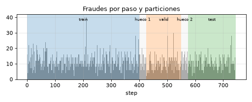
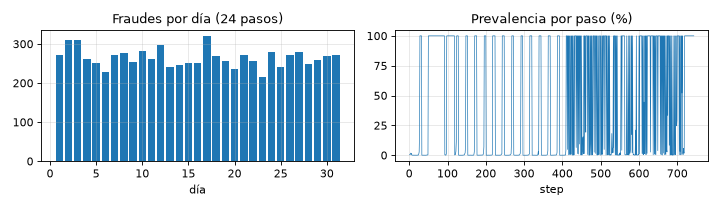
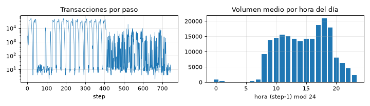

# EDA de PaySim

Generado por `ml/notebooks/01_eda.ipynb` (`make eda`). Solo cifras agregadas. No decide los cortes ni el
conjunto de features A o B: son decisiones pendientes.

## Resumen

- 6,362,620 filas, 743 pasos distintos de 1 h (step máximo 743; la ficha dice 744), 8,213 fraudes (prevalencia 0.129 %).
- Fraude solo en TRANSFER y CASH_OUT: **sí** ({'CASH_OUT': 4116, 'TRANSFER': 4097, 'CASH_IN': 0, 'DEBIT': 0, 'PAYMENT': 0}).
- Fraudes por día: entre 216 y 320; días sin fraude: 0.
- Volumen por paso **no estacionario** en tendencia (ver §Volumen).
- Orígenes que aparecen una sola vez: 99.85 % de los orígenes distintos.
- Destinos de la prueba ya vistos en entrenamiento: 40.66 % de las filas.
- Fuga de saldos: en los fraudes `newbalanceOrig` es 0 en el 98.05 % y la cuenta se vacía
  (`oldbalanceOrg == amount`) en el 97.82 %.
- `isFlaggedFraud` marca 16 filas y captura 16 fraudes (0.195 % del total).

## Fraudes por partición (cortes de `ml/config.yaml`)

| partición | pasos | filas | fraudes | prevalencia_% | fraudes_en_config_types |
|---|---|---|---|---|---|
| train | 1-400 | 5,787,030 | 4,477 | 0.0774 | 4,477 |
| hueco 1 | 401-424 | 209,359 | 308 | 0.1471 | 308 |
| valid | 425-550 | 169,630 | 1,280 | 0.7546 | 1,280 |
| hueco 2 | 551-574 | 34,290 | 286 | 0.8341 | 286 |
| test | 575-744 | 162,311 | 1,862 | 1.1472 | 1,862 |

Los huecos miden 24 pasos (correcto). Mínimo de fraudes en una partición
usada: 1,280 (umbral de §5c: 500).

## Filas, fraudes y prevalencia por tipo

| type | rows | fraud | prevalence_% |
|---|---|---|---|
| CASH_IN | 1,399,284 | 0 | 0.0 |
| CASH_OUT | 2,237,500 | 4,116 | 0.184 |
| DEBIT | 41,432 | 0 | 0.0 |
| PAYMENT | 2,151,495 | 0 | 0.0 |
| TRANSFER | 532,909 | 4,097 | 0.7688 |

CASH_IN (1,399,284 filas) no figura en `config.types`.

La prevalencia por paso es inestable (pasos de madrugada con pocas filas): ver el gráfico; la de cada partición está en la tabla de arriba.

## Volumen por paso

Media 8,563 transacciones/paso, desviación 13,389 (CV 1.56), mínimo 2, máximo 51,352.
Spearman paso–volumen: ρ = -0.276 (p = 2e-14); pendiente -23.94 tx/paso por paso.
Mitad 1 frente a mitad 2: 14,168 frente a 2,974 (Mann–Whitney p = 1.2e-15).
Primer día 23,927/paso, último 12/paso. Razón máx/mín de la hora del día: 522.0.
Primeros 12 pasos: [2708, 1014, 552, 565, 665, 1660, 6837, 21097, 37628, 35991, 37241, 36153].

## Orígenes y destinos

- Orígenes distintos: 6,353,307; aparecen una sola vez: 99.85 % (sobre las filas: 99.71 %).
- Destinos distintos: 2,722,362; una sola vez: 83.12 %; filas cuyo destino se repite: 64.44 %.
  Cuantiles de apariciones por destino (p50/p90/p99): {0.5: 1.0, 0.9: 5.0, 0.99: 25.0}; máximo 113.
  Filas con destino comerciante (`M...`): 33.81 %.
- Partición de prueba (tipos de `config.types`), fracción cuyo destino aparece en entrenamiento:
  filas 40.66 %; destinos distintos 39.40 %;
  solo destinos no comerciantes 73.10 %.
  En filas de fraude 29.86 %; en filas legítimas 40.83 %.

## Fuga en saldos

| medida | fracción |
|---|---|
| fraude: newbalanceOrig == 0 | 0.9805 |
| legítimo: newbalanceOrig == 0 | 0.5668 |
| fraude: oldbalanceOrg == amount (vacía la cuenta) | 0.9782 |
| legítimo: oldbalanceOrg == amount | 0.0 |
| fraude: newbalanceOrig == oldbalanceOrg - amount | 0.9945 |
| fraude: oldbalanceDest == 0 | 0.6515 |
| legítimo: oldbalanceDest == 0 | 0.4248 |
| fraude: newbalanceDest == oldbalanceDest + amount | 0.435 |
| fraude: oldbalanceOrg == 0 | 0.005 |
| legítimo: oldbalanceOrg == 0 | 0.3309 |
| TRANSFER/CASH_OUT legítimo: newbalanceOrig == 0 | 0.901 |
| TRANSFER/CASH_OUT legítimo: oldbalanceDest == 0 | 0.139 |
| TRANSFER/CASH_OUT legítimo: oldbalanceOrg == amount | 0.0 |

`isFlaggedFraud`: 16 filas marcadas (tipos {'TRANSFER': 16, 'CASH_IN': 0, 'CASH_OUT': 0, 'DEBIT': 0, 'PAYMENT': 0}), importe mínimo 353874.22.
16 son fraude: captura 0.195 % de los fraudes. Hay 409,110 TRANSFER con
`amount > 200.000`, de las que 16 están marcadas y 2,740 son fraude.
Es una regla de importe, no una etiqueta: prohibida como entrada (`contracts/features.yaml`).
