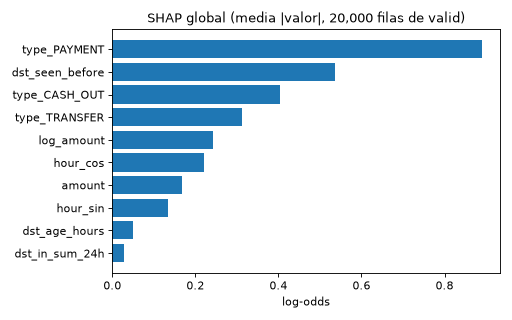

# Informe del modelo de fraude

Generado por `make ml-report`. Hiperparámetros, umbrales y selección usan solo `valid`; `test` se evalúa una vez con todo congelado.

## Modelo servido
**Decisión pendiente.** criterio(s) indeterminado(s): pr_auc_intervals_do_not_overlap. No hay `thresholds.json` ni alias `champion`.

| Criterio | Regla | Valor | Resultado |
|---|---|---|---|
| pr_auc_gain | PR-AUC(xgb) - PR-AUC(logreg) >= 0.02 | 0.2031 | PASS |
| pr_auc_intervals_do_not_overlap | low(xgb) > high(logreg) con bloques de 24 pasos y al menos 10 bloques en valid | {"n_blocks_valid": 6, "block_steps": 24, "logreg_pr_auc_interval": [0.24878556714140873, 0.47883977767545627], "xgb_pr_auc_interval": [0.48024692312267847, 0.6441889785785091]} | INDETERMINADO |
| cost_lower | costo(xgb) < costo(logreg) en valid, cada uno con sus umbrales | {"logreg": 533098846.56, "xgb": 530831837.98} | PASS |
| inference_p95 | p95 de xgb en ONNX Runtime < 10 ms | 0.004519 | PASS |

Intervalos de PR-AUC en `valid` con bloques de 24 pasos (6 bloques; el mínimo fiable es 10) y de 6 pasos (21 bloques):

| Modelo | Bloques de 24 pasos | Bloques de 6 pasos |
|---|---|---|
| logreg | [0.2488, 0.4788] | [0.2536, 0.4783] |
| xgb | [0.4802, 0.6442] | [0.4817, 0.6467] |

Latencia de inferencia (ONNX Runtime, un hilo, una fila por llamada, 10,000 llamadas): logreg p95 0.0048 ms; xgb p95 0.0045 ms.

## Métricas en valid (pasos 425–550)

### logreg (model=logreg, C=10.0)

| Métrica | Valor | Intervalo 95 % (bloques de 24) |
|---|---|---|
| PR-AUC | 0.3595 | [0.2488, 0.4788] |
| Recall a FPR 0.5% (FPR real 0.499%) | 0.4000 | [0.3534, 0.4383] |
| Recall ponderado por monto a FPR 0.5% | 0.7566 | [0.6889, 0.7966] |
| Recall a FPR 0.1% (FPR real 0.099%) | 0.1789 | [0.1399, 0.2134] |
| Recall ponderado por monto a FPR 0.1% | 0.6213 | [0.5314, 0.6702] |
| Costo C | 533,098,847 | [359358291, 653825821] |
| Costo sin modelo (todo aprobado) | 1,903,418,013 | – |
| Tasa de revisión / de bloqueo | 0.499% / 0.176% | – |
| FPR de bloqueo | 0.0493% | – |
| Recall de bloqueo / de revisión-o-bloqueo | 0.1305 / 0.3547 | – |

Sensibilidad del costo (umbrales fijos; costos unitarios ×0,5 / ×1 / ×1,5):

| review × / block_fp × | Costo |
|---|---|
| 0.5 / 0.5 | 533,097,386 |
| 0.5 / 1 | 533,097,866 |
| 0.5 / 1.5 | 533,098,346 |
| 1 / 0.5 | 533,098,367 |
| 1 / 1 | 533,098,847 |
| 1 / 1.5 | 533,099,327 |
| 1.5 / 0.5 | 533,099,348 |
| 1.5 / 1 | 533,099,828 |
| 1.5 / 1.5 | 533,100,308 |

### xgb (model=xgb, max_depth=6, scale_pos_weight=300, best_iteration=20)

| Métrica | Valor | Intervalo 95 % (bloques de 24) |
|---|---|---|
| PR-AUC | 0.5626 | [0.4802, 0.6442] |
| Recall a FPR 0.5% (FPR real 0.463%) | 0.5320 | [0.4933, 0.5590] |
| Recall ponderado por monto a FPR 0.5% | 0.8615 | [0.8190, 0.8883] |
| Recall a FPR 0.1% (FPR real 0.096%) | 0.3891 | [0.3471, 0.4190] |
| Recall ponderado por monto a FPR 0.1% | 0.6582 | [0.6075, 0.6882] |
| Costo C | 530,831,838 | [319697025, 729112713] |
| Costo sin modelo (todo aprobado) | 1,903,418,013 | – |
| Tasa de revisión / de bloqueo | 0.497% / 0.339% | – |
| FPR de bloqueo | 0.0416% | – |
| Recall de bloqueo / de revisión-o-bloqueo | 0.3055 / 0.4781 | – |

Sensibilidad del costo (umbrales fijos; costos unitarios ×0,5 / ×1 / ×1,5):

| review × / block_fp × | Costo |
|---|---|
| 0.5 / 0.5 | 530,830,455 |
| 0.5 / 1 | 530,830,860 |
| 0.5 / 1.5 | 530,831,265 |
| 1 / 0.5 | 530,831,433 |
| 1 / 1 | 530,831,838 |
| 1 / 1.5 | 530,832,243 |
| 1.5 / 0.5 | 530,832,411 |
| 1.5 / 1 | 530,832,816 |
| 1.5 / 1.5 | 530,833,221 |

Los umbrales de FPR fija (0,5 % y 0,1 %) se fijan en valid; el FPR real es el de esa partición.

## Umbrales (fijados en valid)

| Modelo | t_block (FPR de bloqueo ≤ 0,05 %) | t_review (mín. C, revisión ≤ 0,5 %, ≤ t_block) |
|---|---|---|
| logreg | 0.98974 | 0.95301 |
| xgb | 0.90380 | 0.83142 |

Decisión: `score = round(p, 5)`; BLOCK si `score >= t_block`; si no, REVIEW si `score >= t_review`; si no, APPROVE.

## Métricas en test (pasos 575–744, evaluado una vez)

Aún no se ha ejecutado `make ml-eval-test`.

## Explicabilidad

SHAP global del XGBoost (TreeExplainer, 20,000 filas de valid):

| Feature | Media |SHAP| |
|---|---|
| type_PAYMENT | 0.8891 |
| dst_seen_before | 0.5360 |
| type_CASH_OUT | 0.4035 |
| type_TRANSFER | 0.3132 |
| log_amount | 0.2414 |
| hour_cos | 0.2201 |
| amount | 0.1677 |
| hour_sin | 0.1346 |
| dst_age_hours | 0.0507 |
| dst_in_sum_24h | 0.0290 |

Regresión logística: coeficiente por valor estandarizado (log-odds por desviación típica):

| Feature | Coeficiente |
|---|---|
| type_PAYMENT | -3.4969 |
| type_CASH_OUT | +2.5202 |
| type_TRANSFER | +1.6800 |
| dst_seen_before | -0.7542 |
| hour_cos | +0.7330 |
| hour_sin | +0.6161 |
| amount | +0.5587 |
| type_DEBIT | -0.4565 |
| dst_in_sum_24h | -0.2987 |
| dst_age_hours | -0.2587 |
| src_out_sum_24h | -0.0878 |
| src_out_count_1h | -0.0266 |
| dst_in_count_24h | -0.0224 |
| dst_distinct_src_24h | -0.0224 |
| src_out_count_24h | +0.0076 |
| log_amount | -0.0044 |
| is_new_beneficiary | +0.0000 |

## Ablación: conjunto B (con saldo), solo valid

| Modelo | PR-AUC A | PR-AUC B | Recall@0,5 % A | Recall@0,5 % B |
|---|---|---|---|---|
| logreg | 0.3595 | 0.5925 | 0.4000 | 0.5234 |
| xgb | 0.5626 | 0.9911 | 0.5320 | 1.0000 |

Mayores ganancias del XGBoost con B: {'amount_to_balance': 0.8203272819519043, 'src_balance_before': 0.10046707093715668, 'type_PAYMENT': 0.03145136311650276, 'amount': 0.012537729926407337, 'type_CASH_OUT': 0.006349943578243256}.

El PR-AUC de B es ≥ 0.95: es el artefacto del simulador descrito en §5b (el fraude vacía la cuenta) y B no se sirve.

## Limitaciones

- Datos sintéticos (PaySim): las cifras no se extrapolan a clientes reales.
- El fraude solo ocurre en TRANSFER y CASH_OUT; el modelo no ha visto fraude en PAYMENT ni DEBIT.
- Cambio de régimen en el volumen alrededor del paso 400 (ver `eda.md`): la prevalencia pasa de 0,08 % en train a 0,75 % en valid y 1,15 % en test; los umbrales fijados en valid no se trasladan limpiamente.
- Pocos bloques de pasos: 6 en valid con bloques de 24 pasos; los intervalos por bootstrap de bloques son poco fiables por debajo de 10.
- Casi todos los orígenes aparecen una sola vez: `src_out_*` e `is_new_beneficiary` casi no aportan información en PaySim.
- El costo está dominado por el monto de los fraudes aprobados; los costos unitarios son supuestos (sensibilidad ±50 %).
